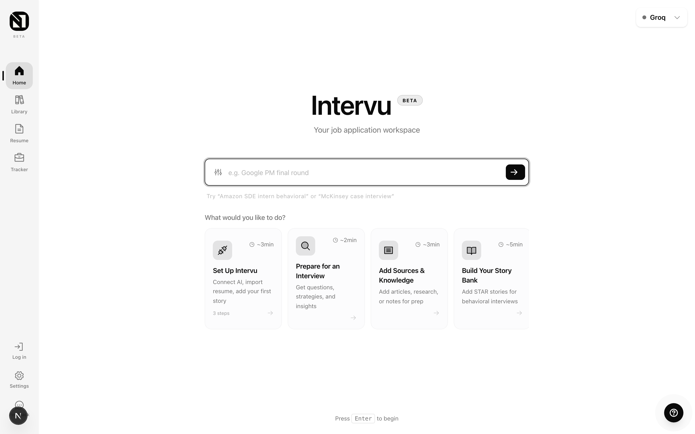

<p align="center">
  
</p>

<h1 align="center">Intervu</h1>

<p align="center">
  Your AI-powered job application workspace.<br/>
  Resumes, applications, interview prep, and job search in one place.
</p>

<p align="center">
  <a href="#getting-started">Get Started</a> &middot;
  <a href="#features">Features</a> &middot;
  <a href="DEPLOY.md">Deploy</a> &middot;
  <a href="LICENSE">License</a>
</p>



---

## What is Intervu?

Intervu ([intervu.cc](https://intervu.cc)) is a single workspace for the whole job
search loop: discover roles, tailor your resume, write cover letters, track
applications, and prep for the interview.

- **Credits + BYOK** — Generations run on a shared, app-funded model with a small
  free monthly grant. Out of credits? Bring your own [OpenRouter](https://openrouter.ai)
  or [Groq](https://console.groq.com) key in Settings and you're never charged or
  rate-limited — you pay the provider directly.
- **Keys encrypted at rest** — Your provider keys are AES-encrypted server-side and
  never round-trip through the browser in plaintext.
- **Job search built in** — A large jobs corpus (served by a self-hosted
  Meilisearch index) with a ghost-job signal so you don't waste applications on
  stale listings.

---

## Features

### Interview Prep Engine

Type a company, role, and round in natural language (e.g. *"Google PM final round"*)
and Intervu generates a full prep package:

| Section | What it does |
|---|---|
| **Company Recon** | Culture, recent news, interview style, and "vibe" analysis |
| **Match Strategy** | Maps your resume to the role and builds a positioning narrative |
| **Question Bank** | Behavioral, situational, and role-specific questions with strategies |
| **Reverse Interview** | Smart questions to ask your interviewer |
| **Technical Concepts** | Key topics to review for technical roles |
| **Coding Workspace** | Practice problems with a Monaco-based code editor |
| **System Design** | Architecture questions tailored to the role's level |

### Resume Builder & Tailoring

- Build a structured resume from scratch or import from PDF / DOCX / text
- Paste a job posting URL and get AI-powered tailoring recommendations
- Save multiple resume versions — one per application
- Export to PDF or DOCX

### Application Tracker

- Track applications across statuses: Applied, Interviewing, Offer, Rejected, Withdrawn
- Link tailored resume versions to each application
- Generate cover letters with one click
- Jump straight from a tracked application into interview prep

### Job Search

- Search a large jobs corpus from the **Find jobs** tab (powered by Meilisearch)
- Ghost-job signal flags listings that look stale or re-posted
- "Apply" deep-links you out to the original posting and records it in your tracker

### STAR Story Bank & Knowledge Sources

- Store behavioral stories in the STAR format; they're referenced during question prep
- Add articles, notes, or URLs as knowledge sources the AI draws on for personalized output

### Personality-Driven Copy & Interactive Tour

- All user-facing text lives in `src/lib/copy.ts` (single source of truth, randomized per visit)
- A rotating motivational banner and a contextual onboarding tour guide new users

---

## AI Providers

| Mode | Provider | Notes |
|---|---|---|
| **Shared (default)** | OpenRouter | App-funded, credit-metered. Small free monthly grant per account. |
| **BYOK** | OpenRouter or Groq | Add your own key in Settings → never charged, never rate-limited. |
| **Transcription** | Groq (Whisper) | Used for in-app audio transcription. |

Admins get unlimited use of the shared key. Anonymous (signed-out) users cannot use
the shared key — sign in, or bring your own key.

---

## Tech Stack

| Layer | Technology |
|---|---|
| Framework | [Next.js 16](https://nextjs.org/) (App Router, Turbopack, Server Actions), [React 19](https://react.dev/) |
| Auth & Data | [Firebase](https://firebase.google.com/) — Auth (session cookies) + Firestore |
| Styling | [Tailwind CSS 4](https://tailwindcss.com/) (CSS-variable design tokens, dark mode) + Radix UI primitives |
| Icons | [Phosphor Icons](https://phosphoricons.com/) + [Lucide](https://lucide.dev/) |
| AI | OpenRouter (via the OpenAI SDK) + [Groq SDK](https://groq.com/) |
| Job search | [Meilisearch](https://www.meilisearch.com/) (self-hosted), Subspace jobs API |
| Code Editor | [Monaco Editor](https://microsoft.github.io/monaco-editor/) |
| PDF / DOCX | unpdf, mammoth, jspdf, docx |
| Validation | [Zod](https://zod.dev/) (server-action input boundaries) |
| Testing | [Playwright](https://playwright.dev/) (E2E) + `node:test` via `tsx` (unit) |
| Encryption | CryptoJS (AES) |

---

## Getting Started

### Prerequisites

- **Node.js 20+**
- A **Firebase** project (Auth + Firestore enabled) with a service account
- An [OpenRouter](https://openrouter.ai/keys) key for the shared model (and/or let users BYOK)
- *(Optional)* A running **Meilisearch** instance for the jobs corpus

### 1. Clone & install

```bash
git clone https://github.com/vvknyn/intervu.git
cd intervu
npm install
```

### 2. Configure environment

Create `.env.local` in the project root and fill in:

```env
# --- Firebase (client) — public-by-design, inlined into the bundle ---
NEXT_PUBLIC_FIREBASE_API_KEY=...
NEXT_PUBLIC_FIREBASE_AUTH_DOMAIN=your-project.firebaseapp.com
NEXT_PUBLIC_FIREBASE_PROJECT_ID=your-project
NEXT_PUBLIC_FIREBASE_STORAGE_BUCKET=your-project.appspot.com
NEXT_PUBLIC_FIREBASE_MESSAGING_SENDER_ID=...
NEXT_PUBLIC_FIREBASE_APP_ID=...

# --- Firebase Admin (server) — SECRET. Either the JSON blob… ---
FIREBASE_SERVICE_ACCOUNT_KEY={"type":"service_account",...}
# …or the three individual fields (PRIVATE KEY is the PEM block from the service
# account JSON, with literal newlines escaped as \n):
# FIREBASE_CLIENT_EMAIL=...
# FIREBASE_PRIVATE_KEY="<your service-account PEM, newlines as \n>"

# --- AI ---
OPENROUTER_API_KEY=sk-or-...   # shared, app-funded model
GROQ_API_KEY=gsk_...           # audio transcription (Whisper)

# --- Secrets ---
# Encrypts users' BYOK provider keys at rest. Generate: openssl rand -hex 32
ENCRYPTION_KEY=your-32-byte-hex-key
# Comma-separated admin emails (unlimited shared-key use). Defaults to the owner.
ADMIN_EMAILS=you@example.com

# --- Jobs (optional; the Find-jobs tab is empty without these) ---
MEILISEARCH_HOST=https://your-meili-host
MEILISEARCH_SEARCH_KEY=...      # read-only search key used at request time
# MEILISEARCH_ADMIN_KEY / MEILISEARCH_API_KEY are used only by the off-Vercel sync worker
SUBSPACE_API_BASE_URL=...
SUBSPACE_API_KEY=...
```

> `.env.local` is gitignored. Never commit real keys. The `NEXT_PUBLIC_FIREBASE_*`
> values are public-by-design (they ship in the client bundle); everything else is
> a server secret.

### 3. Run

```bash
npm run dev
```

Open [http://localhost:3000](http://localhost:3000). Create an account, connect a
provider (or rely on the shared credits), and import your resume.

---

## Scripts

```bash
npm run dev          # Development server
npm run build        # Production build
npm start            # Production server
npm run lint         # ESLint
npm test             # All Playwright E2E tests
npm run test:unit    # Unit tests (node:test via tsx)
```

Unit tests under `tests/unit/` run directly with `tsx`, e.g.:

```bash
npx tsx --test tests/unit/validation.test.ts
npx tsx --test tests/unit/url-safety.test.ts
```

Targeted Playwright suites are exposed as `npm run test:nav`, `test:auth`,
`test:dash`, `test:resume`, `test:tailor`, `test:apps`, `test:settings`,
`test:mobile`, and `test:privacy`.

---

## Project Structure

```
intervu/
├── .github/workflows/
│   ├── ci.yml                  # Lint + typecheck + build on PR/push
│   └── update-readme-stats.yml # Auto-updates README stats
│
├── src/
│   ├── app/                    # Next.js routes (App Router)
│   │   ├── page.tsx            # Home / dashboard
│   │   ├── jobs/               # Job search (Meilisearch)
│   │   ├── applications/       # Application tracker
│   │   ├── resume-builder/     # Resume creation
│   │   ├── resume-tailor/      # Resume optimization
│   │   ├── library/            # Stories & sources
│   │   ├── settings/           # Account & AI config
│   │   ├── error.tsx           # Route error boundary
│   │   ├── not-found.tsx       # 404
│   │   ├── robots.ts           # /robots.txt
│   │   ├── sitemap.ts          # /sitemap.xml
│   │   └── opengraph-image.tsx # OG/Twitter card (next/og)
│   │
│   ├── actions/                # Server actions (data + AI)
│   ├── components/             # UI components
│   ├── lib/                    # Utilities
│   │   ├── llm/                # Provider config, credit gate, sentinels
│   │   ├── jobs/               # Meilisearch + Subspace jobs client + sync
│   │   ├── firebase/           # Client + Admin SDK setup, auth session
│   │   ├── validation.ts       # Zod input-validation chokepoint
│   │   ├── url-safety.ts       # SSRF guards for user-supplied URLs
│   │   ├── encryption.ts       # AES encrypt/decrypt for BYOK keys
│   │   └── copy.ts             # Centralized user-facing copy
│   │
│   └── types/                  # TypeScript definitions
│
├── firestore.rules             # Firestore security rules
├── next.config.ts              # Security headers, CSP, images
├── tests/                      # Playwright E2E + node:test unit
└── public/                     # Static assets
```

---

## Security

- **HTTP headers** — `next.config.ts` sets HSTS, `X-Frame-Options: DENY`,
  `X-Content-Type-Options: nosniff`, `Referrer-Policy`, a `Permissions-Policy`, and
  a Content-Security-Policy (currently Report-Only; see the file's TODO before
  enforcing).
- **Firestore rules** — owner-scoped reads/writes with a default-deny catch-all.
- **Input validation** — mutating server actions validate input through the Zod
  chokepoint in `src/lib/validation.ts`.
- **SSRF** — user-supplied URLs (resume tailoring, link discovery) pass through
  `src/lib/url-safety.ts`, which blocks private/loopback/metadata ranges and
  re-checks every redirect hop.
- **Keys** — BYOK provider keys are AES-encrypted at rest; the shared key is never
  handed to anonymous callers.

---

## License

See [LICENSE](LICENSE).
