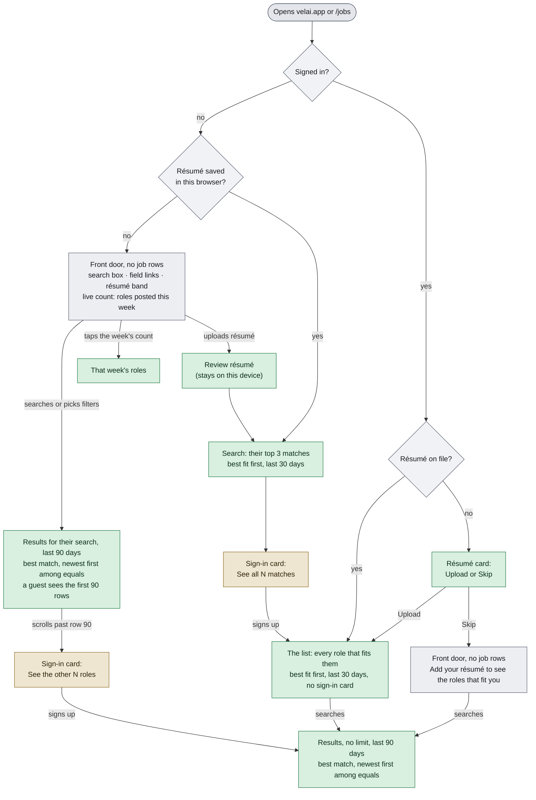

# Journey map

A readable map of the journeys in [CATALOG.md](CATALOG.md), grouped by where a visitor is on their way through Velai. For a product person it says what each stage is and what is broken; for an engineer it says which catalog rows guard each stage and how many have a spec. CATALOG.md stays the source of truth: IDs, wording and status live there, and the stage table below is generated from it.

## Where job lists appear

**The rule:** a list of jobs appears only when there is a reason for it: the visitor's résumé, their own search or filters, or the specific job, company or career page they came for. Since release 16 (#711, #723):
- Bare /jobs is a front door with no rows: the search box, the field links, a live count of the week's roles in the visitor's country plus remote (tapping it opens that week's roles), their last search, and the résumé band.
- A résumé on file opens the list on the roles ranked against it, from the last 30 days, one row per employer: a guest sees their top 3, then a sign-in card; a signed-in user sees the whole list. It is one page shape signed in or out: there is no For you dashboard, packs hub, Today or For you / Search switch, and an old `?view=for-you` link opens this list. The list says how many roles fit and what it left out and why.
- Typed search stays open to guests and covers the last 90 days, newer roles first among equally good matches. A guest sees the first 90 rows, then a sign-in card. A country search no longer lists remote roles tagged to a city or state elsewhere.
- Company and job pages stay public.

What a visitor sees arriving on /jobs. Green: a list with a reason behind it; grey: the front door, no rows; tan: a sign-in card.

## Stages

Each catalog row belongs to one stage. **Covered**: a tagged spec runs it. **Known-bug**: status `known-bug` (a spec wrapped in `test.fail()`). **Bug noted**: an uncovered row whose text says what should happen and ends "(known bug: …)"; it needs a spec before it can take the `known-bug` status. Numbers skipped in a range are rows deleted or merged, or rows other open PRs are adding.

<!-- stage-table:start (generated by node scripts/journey-map-counts.mjs --write) -->
| Stage | Catalog rows | Rows | Covered | Uncovered | Known-bug | Bug noted |
|-------|--------------|-----:|--------:|----------:|----------:|----------:|
| [Landing on /jobs with no search](#landing-on-jobs-with-no-search) | JOBS 01, 03, 21, 24–25, 29–30, 55, 58, 60, 65–66 · SRCH 01–02, 18 · MOB 01, 14, 16–18, 23 · ALERTS 21–23 · NAV 01, 06, 21 · SPEED 05–08 | 31 | 17 | 14 | 0 | 0 |
| [Search, filters and results](#search-filters-and-results) | JOBS 04–08, 14–18, 26, 28, 67–74 · SRCH 03–17, 19–23, 30–40 · FILT 01–26 · MOB 02, 11–13, 21, 25–28 · SPEED 01–04 | 90 | 32 | 58 | 0 | 0 |
| [Résumé upload and top matches](#résumé-upload-and-top-matches) | JOBS 34–36, 54, 56–57, 59, 61, 76–78, 90–91, 93, 103, 107, 121–122, 124 · AUTH 31–33 · RESUME 08, 28–29, 40–44, 46–49, 51 · MODAL 01 | 36 | 29 | 7 | 0 | 0 |
| [The résumé-ranked list: what fits and what is left out](#the-résumé-ranked-list-what-fits-and-what-is-left-out) | JOBS 31, 37, 52, 99–100, 102, 105, 110–111, 115–118, 120, 125–138, 140–142, 144–146, 148, 150–158 · NAV 31–32 | 46 | 45 | 1 | 0 | 0 |
| [Job detail: pane, sheet, page](#job-detail-pane-sheet-page) | JOBS 09–13, 23, 53, 75, 104 · MOB 03, 09–10, 24 · DETAIL 01–37, 40–45 · ERR 07–08 | 58 | 24 | 34 | 0 | 0 |
| [Apply](#apply) | APPLY 01–33 | 33 | 9 | 24 | 0 | 0 |
| [Save and tracker](#save-and-tracker) | JOBS 32–33 · TRACKER 01–77 · NAV 10 · MODAL 04 | 81 | 34 | 47 | 0 | 0 |
| [Saved searches, alerts, follows](#saved-searches-alerts-follows) | JOBS 22 · ALERTS 01–16, 18–20, 26–29, 31–41, 43–48 | 41 | 11 | 30 | 0 | 0 |
| [Company pages](#company-pages) | COMPANY 01–02, 04–31, 35–42, 44–49 | 44 | 15 | 29 | 0 | 0 |
| [Sign in and create account](#sign-in-and-create-account) | JOBS 79 · AUTH 01–30, 34–36, 39–56 · NAV 03–05, 17–19 | 58 | 13 | 45 | 0 | 0 |
| [New-account setup](#new-account-setup) | ONBOARD 01–10 | 10 | 10 | 0 | 0 | 0 |
| [Résumé page and Customize](#résumé-page-and-customize) | RESUME 01–07, 09–23, 25–27, 30–39, 45, 50, 52–54 · MODAL 03, 06 | 42 | 17 | 25 | 0 | 0 |
| [Settings and account](#settings-and-account) | SETTINGS 01–11, 13–20, 22–34 · NAV 11–13, 20 | 36 | 7 | 29 | 0 | 0 |
| [AI agents: Connect, OAuth, MCP](#ai-agents-connect-oauth-mcp) | COMPANY 32–34 · CONNECT 01–31 · OAUTH 01–22 | 56 | 12 | 44 | 0 | 0 |
| [Career hubs, comparison pages, content, SEO](#career-hubs-comparison-pages-content-seo) | CONTENT 01–07, 09–40 · SEO 01–09 | 48 | 16 | 32 | 0 | 0 |
| [Pricing and founding seat](#pricing-and-founding-seat) | PRICING 01–11 | 11 | 6 | 5 | 0 | 0 |
| [Header, menus, errors, layout](#header-menus-errors-layout) | MOB 04–08, 19, 22 · NAV 07–09, 14, 22–29, 33–42 · ERR 01–06, 10–15, 17–18 · ADMIN 01–05 · MODAL 02, 05 | 50 | 15 | 35 | 0 | 0 |
| **All stages** | | **771** | **312** | **459** | **0** | **0** |
<!-- stage-table:end -->

### Landing on /jobs with no search

What someone sees when they open velai.app or /jobs without typing anything: the front door with no rows. The search box, the field links, a live count of the week's roles (tapping it opens them), a return card with a returning guest's last search, the résumé band and, on a phone, the Search button. A visitor with a résumé on file opens on their ranked list instead (next stages).

### Search, filters and results

Typing a search or picking filters, and everything on the results list: suggestions, location, filters and their chips, the 90-day default window, sort, loading more up to a guest's 90 rows, and the empty, stale and error states.

### Résumé upload and top matches

Adding a résumé from /jobs, checking what was read from it, and seeing roles ranked against it: a guest sees their top 3, then a sign-in card; a signed-in user sees the whole list. A résumé on file opens Search on this list once per visit. Also the board's prompts to add one ("Rank with my résumé", the résumé moment) and the résumé step right after sign-up.

### The résumé-ranked list: what fits and what is left out

What the list does once a résumé is on file, signed in or not: which roles it keeps (last 30 days, the country and level the résumé can take, its own kind of role, one row per employer), the count line and what it left out and why, the fit label and reason on each row, applied roles kept out, and what it shows when nothing fits, the place has no roles, or a read fails. The Chrome extension tile sits in it once.

### Job detail: pane, sheet, page

Opening one job: the side pane on a wide screen, the bottom sheet on a phone, and the public /jobs/<slug> page that shared links open, with save, share and report.

### Apply

Pressing Apply. A guest is asked to sign in first and the apply picks up afterwards; a signed-in user goes to the employer's site and, on coming back, is asked "Did you apply?" so the tracker can record it.

### Save and tracker

Saving roles and tracking applications on /yours (the lanes, the detail sheet, the full pursuit page) and History, for a guest in this browser and for an account, including the sync at first sign-in.

### Saved searches, alerts, follows

Hearing about new roles: saved searches, email alerts for a search, following a company, the follow-alerts bell, the confirm links in those emails, and unsubscribe.

### Company pages

Public company pages (/co/<company>) and name-keyed /companies pages: the company's open roles and role search, Follow, the record kept behind sign-in, and what following unlocks.

### Sign in and create account

/login and the sign-in dialog: Google, passkey and email-code handoff, form errors, password reset, where the visitor lands afterwards (`next=`), and the prompts that ask a guest to sign in.

### New-account setup

What a new account gets after it signs up: the page it signed in on, a one-line welcome strip, three skippable steps (what you want, where you can work, a weekly email) in a sheet or as /jobs itself, and "Finish setup" in the account menu.

### Résumé page and Customize

The /resume page for a guest (a résumé kept in this browser) and for an account (upload, replace, delete, edit, download), plus Customize résumé on a role.

### Settings and account

/settings: the Résumé, Preferences and Account tabs, the account email and weekly digest, on-device AI, signing out and deleting the account, and the account menu that leads there.

### AI agents: Connect, OAuth, MCP

Connecting an AI assistant: the /connect setup for Claude, ChatGPT, Gemini and Cursor, the OAuth consent screen, the MCP endpoint agents call, and the /watch pages (catalogued as J-COMPANY-32 to 34).

### Career hubs, comparison pages, content, SEO

The pages around the product: career hubs, the Indeed, LinkedIn and Eluta alternative pages, trends and research, privacy, terms, contact and stories, plus what crawlers read (robots, sitemap, page metadata).

### Pricing and founding seat

The pricing page, reserving or buying a founding seat, and what a signed-in visitor sees there.

### Header, menus, errors, layout

The frame around every page: the header, the phone tab bar, the footer, menus, control and type sizes, the 404 and error pages, and who can open /admin.

## Known problems

None open in the catalog. Every problem the audit found at staging 8baeaee is fixed on staging now, and its row has a spec: J-JOBS-11 (closing a job from a shared link stays on Velai), J-APPLY-01, J-APPLY-29 and J-APPLY-30 (the Apply sign-in dialog), J-COMPANY-17 and J-COMPANY-18 (follow links and a verified guest's follows), J-ALERTS-09 (no guest alert form for a signed-in user), J-ALERTS-11, J-ALERTS-12 and J-ALERTS-41 (confirm links say whether they worked), J-SETTINGS-31, J-CONNECT-24, J-OAUTH-19 and J-FILT-08.

Rows written around the same bugs now describe the working behaviour and still need specs: J-OAUTH-02, J-OAUTH-20, J-OAUTH-22, J-CONNECT-25, J-CONNECT-28 and J-AUTH-46.

## Keeping this current

- Add or change the row in [CATALOG.md](CATALOG.md) first; the Contract there still applies (tag, Writes, status).
- Put the row in the right stage. Rows in APPLY, TRACKER, ALERTS, COMPANY, AUTH, RESUME, SETTINGS, CONNECT, OAUTH, CONTENT, SEO, PRICING, SRCH, FILT, SPEED, DETAIL, ERR and ADMIN land in their area's stage on their own. A row in JOBS, MOB, NAV or MODAL, or one that belongs in another stage than its area's, needs its ID added to `STAGES` in `scripts/journey-map-counts.mjs`.
- Regenerate the stage table: `node scripts/journey-map-counts.mjs --write` (no dependencies). `--check` exits non-zero when the table is stale or a row has no stage.
- When a row's bug is fixed, drop its "(known bug: …)" note, give the row a spec, and take it off the list above. When a change moves where job lists appear, update the rule and the diagram at the top.
