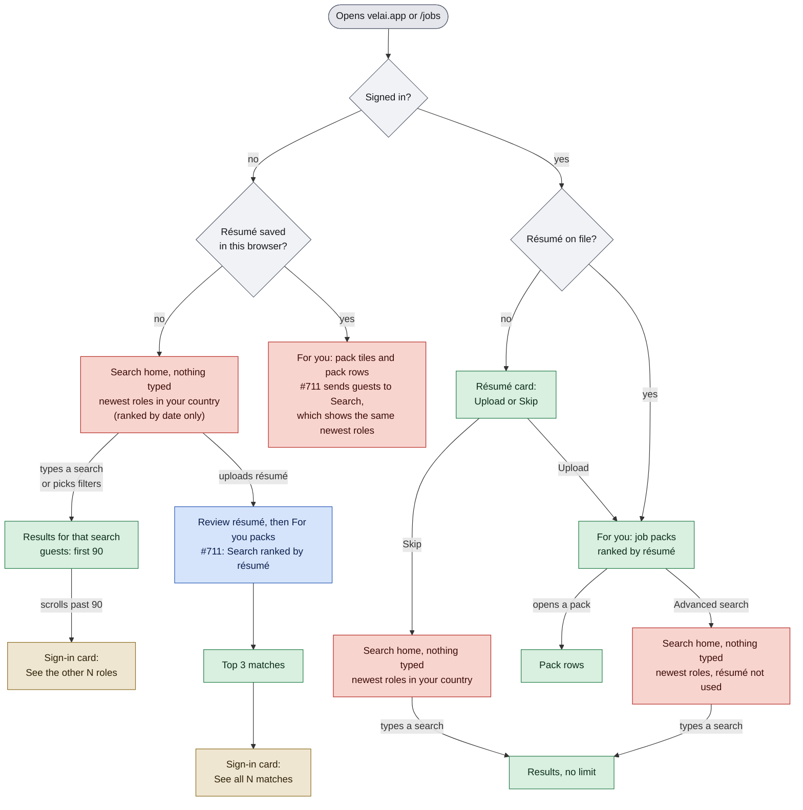
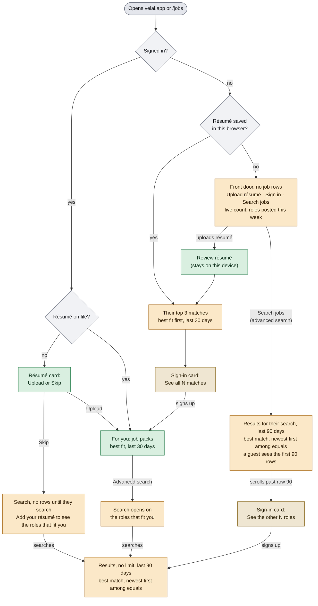

# Journey map

A readable map of the journeys in [CATALOG.md](CATALOG.md), grouped by where a visitor is on their way through Velai. For a product person it says what each stage is and what is broken; for an engineer it says which catalog rows guard each stage and how many have a spec. CATALOG.md stays the source of truth: IDs, wording and status live there, and the stage table below is generated from it.

## Where job lists appear

**The rule the product is moving to:** a list of jobs appears only when there is a reason for it: the visitor's résumé, their own search or filters, or the specific job, company or career page they came for. Bare /jobs becomes a front door with no rows (upload a résumé, sign in, or search). Typed search stays open to guests: the first 90 rows, then a sign-in card. A guest with a résumé sees their top 3 matches, then a sign-in card. Company and job pages stay public. **Live on staging:** guest search with the sign-in card after 90 rows (J-JOBS-06), a guest's top 3 matches and then the sign-in card (J-JOBS-34), and public company and job pages. **In flight:** the For you gate PR #711 (For you needs an account: a signed-out visitor gets one sign-in card instead of job packs; bare /jobs becomes the front door with no rows and a live count of the week's roles; a résumé on file opens Search on the résumé-ranked list, a guest's top 3 then the sign-in card) and the search relevance PR (typed search covers 90 days instead of 30, newer roles first among equally good matches, and a country search stops listing remote roles tagged to a city elsewhere; packs and the résumé-ranked list keep 30 days, because on the pack audit 90 days put an older copy of the same title into the top 3 of 13 of 24 tiles). **Not live until #711 ships:** the front door; bare /jobs still lists the newest roles in the visitor's country (J-JOBS-01).

Today (staging): what a visitor sees arriving on /jobs. Red: a job list with no reason behind it; green: a list with a reason; blue: what #711 changes; tan: a sign-in card.

Proposed: the same arrival under the rule. Orange: new or changed; green: as today; tan: a sign-in card.

## Stages

Each catalog row belongs to one stage. **Covered**: a tagged spec runs it. **Known-bug**: status `known-bug` (a spec wrapped in `test.fail()`). **Bug noted**: an uncovered row whose text says what should happen and ends "(known bug: …)"; it needs a spec before it can take the `known-bug` status. Numbers skipped in a range are rows deleted or merged, or rows other open PRs are adding.

<!-- stage-table:start (generated by node scripts/journey-map-counts.mjs --write) -->
| Stage | Catalog rows | Rows | Covered | Uncovered | Known-bug | Bug noted |
|-------|--------------|-----:|--------:|----------:|----------:|----------:|
| [Landing on /jobs with no search](#landing-on-jobs-with-no-search) | JOBS 01, 03, 21, 24–25, 29–30, 65–66 · SRCH 01–02, 18 · MOB 01, 14, 16–18 · ALERTS 21–23 · NAV 01, 06, 21 | 23 | 7 | 16 | 0 | 0 |
| [Search, filters and results](#search-filters-and-results) | JOBS 04–08, 14–18, 26, 28, 67–74 · SRCH 03–17, 19–21, 30–32 · FILT 01–24 · MOB 02, 11–13, 21 | 70 | 8 | 62 | 0 | 0 |
| [Résumé upload and top matches](#résumé-upload-and-top-matches) | JOBS 34–36, 76–78 · AUTH 31–33 · RESUME 28–29 · MODAL 01 | 12 | 6 | 6 | 0 | 0 |
| [For you: job packs](#for-you-job-packs) | JOBS 19–20, 27, 31, 37–48, 50–52 · NAV 30–32 | 22 | 18 | 4 | 0 | 0 |
| [Job detail: pane, sheet, page](#job-detail-pane-sheet-page) | JOBS 09–13, 23, 53, 75 · MOB 03, 09–10 · DETAIL 01–37 · ERR 07–08 | 50 | 16 | 34 | 0 | 0 |
| [Apply](#apply) | APPLY 01–33 | 33 | 8 | 25 | 0 | 0 |
| [Save and tracker](#save-and-tracker) | JOBS 32–33 · TRACKER 01–66 · NAV 10 · MODAL 04 | 70 | 23 | 47 | 0 | 0 |
| [Saved searches, alerts, follows](#saved-searches-alerts-follows) | JOBS 22 · ALERTS 01–16, 18–20, 26–29, 31–41, 43–45 | 38 | 5 | 33 | 0 | 0 |
| [Company pages](#company-pages) | COMPANY 01–02, 04–31, 35–42, 44–45 | 40 | 11 | 29 | 0 | 0 |
| [Sign in and create account](#sign-in-and-create-account) | JOBS 79 · AUTH 01–30, 34–36, 39–50 · NAV 03–05, 17–19 | 52 | 6 | 46 | 0 | 0 |
| [Résumé page and Customize](#résumé-page-and-customize) | RESUME 01–23, 25–27, 30–36 · MODAL 03, 06 | 35 | 9 | 26 | 0 | 0 |
| [Settings and account](#settings-and-account) | SETTINGS 01–11, 13–20, 22–33 · NAV 11–13, 20 | 35 | 5 | 30 | 0 | 0 |
| [AI agents: Connect, OAuth, MCP](#ai-agents-connect-oauth-mcp) | COMPANY 32–34 · CONNECT 01–28 · OAUTH 01–22 | 53 | 4 | 49 | 0 | 0 |
| [Career hubs, comparison pages, content, SEO](#career-hubs-comparison-pages-content-seo) | CONTENT 01–07, 09–26 · SEO 01–09 | 34 | 1 | 33 | 0 | 0 |
| [Pricing and founding seat](#pricing-and-founding-seat) | PRICING 01–10 | 10 | 5 | 5 | 0 | 0 |
| [Header, menus, errors, layout](#header-menus-errors-layout) | MOB 04–08, 19 · NAV 07–09, 14, 22–29, 33–40 · ERR 01–06, 10–15, 17–18 · ADMIN 01–04 · MODAL 02, 05 | 46 | 12 | 34 | 0 | 0 |
| **All stages** | | **623** | **144** | **479** | **0** | **0** |
<!-- stage-table:end -->

### Landing on /jobs with no search

What someone sees when they open velai.app or /jobs without typing anything. Today that is the search box over the newest roles in their country, with the country chip, a return card for a returning guest and, on a phone, the Search button; under the new rule it becomes the front door with no rows.

### Search, filters and results

Typing a search or picking filters, and everything on the results list: suggestions, location, filters and their chips, sort, loading more up to a guest's 90 rows, and the empty, stale and error states.

### Résumé upload and top matches

Adding a résumé from /jobs, checking what was read from it, and seeing roles ranked against it: a guest sees their top 3, then a sign-in card. Also the board's prompts to add one ("Rank with my résumé", the résumé moment) and the résumé step right after sign-up.

### For you: job packs

The job packs a visitor with a résumé gets on For you: pack tiles and their counts, opening a pack and coming back, the For you / Search switch, and what a pack shows when a read fails. The For you gate PR #711 makes this signed-in only.

### Job detail: pane, sheet, page

Opening one job: the side pane on a wide screen, the bottom sheet on a phone, and the public /jobs/<slug> page that shared links open, with save, share and report.

### Apply

Pressing Apply. A guest is asked to sign in first and the apply picks up afterwards; a signed-in user goes to the employer's site and, on coming back, is asked "Did you apply?" so the tracker can record it.

### Save and tracker

Saving roles and tracking applications on /yours (the lanes, the detail sheet, the full pursuit page) and History, for a guest in this browser and for an account, including the sync at first sign-in.

### Saved searches, alerts, follows

Hearing about new roles: saved searches, email alerts for a search, following a company, the follow-alerts bell, the confirm links in those emails, and unsubscribe.

### Company pages

Public company pages (/co/<company>) and name-keyed /companies pages: the company's open roles and role search, Follow, the record kept behind sign-in, and what following unlocks.

### Sign in and create account

/login and the sign-in dialog: Google, passkey and email-code handoff, form errors, password reset, where the visitor lands afterwards (`next=`), and the prompts that ask a guest to sign in.

### Résumé page and Customize

The /resume page for a guest (a résumé kept in this browser) and for an account (upload, replace, delete, edit, download), plus Customize résumé on a role.

### Settings and account

/settings: the Résumé, Preferences and Account tabs, the account email and weekly digest, on-device AI, signing out and deleting the account, and the account menu that leads there.

### AI agents: Connect, OAuth, MCP

Connecting an AI assistant: the /connect setup for Claude, ChatGPT, Gemini and Cursor, the OAuth consent screen, the MCP endpoint agents call, and the /watch pages (catalogued as J-COMPANY-32 to 34).

### Career hubs, comparison pages, content, SEO

The pages around the product: career hubs, the Indeed, LinkedIn and Eluta alternative pages, trends and research, privacy, terms, contact and stories, plus what crawlers read (robots, sitemap, page metadata).

### Pricing and founding seat

The pricing page, reserving or buying a founding seat, and what a signed-in visitor sees there.

### Header, menus, errors, layout

The frame around every page: the header, the phone tab bar, the footer, menus, control and type sizes, the 404 and error pages, and who can open /admin.

## Known problems

None open in the catalog. Every problem the audit found at staging 8baeaee is fixed on staging now, and its row has a spec: J-JOBS-11 (closing a job from a shared link stays on Velai), J-APPLY-01, J-APPLY-29 and J-APPLY-30 (the Apply sign-in dialog), J-COMPANY-17 and J-COMPANY-18 (follow links and a verified guest's follows), J-ALERTS-09 (no guest alert form for a signed-in user), J-ALERTS-11, J-ALERTS-12 and J-ALERTS-41 (confirm links say whether they worked), J-SETTINGS-31, J-CONNECT-24, J-OAUTH-19 and J-FILT-08.

Rows written around the same bugs now describe the working behaviour and still need specs: J-OAUTH-02, J-OAUTH-20, J-OAUTH-22, J-CONNECT-25, J-CONNECT-28 and J-AUTH-46.

## Keeping this current

- Add or change the row in [CATALOG.md](CATALOG.md) first; the Contract there still applies (tag, Writes, status).
- Put the row in the right stage. Rows in APPLY, TRACKER, ALERTS, COMPANY, AUTH, RESUME, SETTINGS, CONNECT, OAUTH, CONTENT, SEO, PRICING, SRCH, FILT, DETAIL, ERR and ADMIN land in their area's stage on their own. A row in JOBS, MOB, NAV or MODAL, or one that belongs in another stage than its area's, needs its ID added to `STAGES` in `scripts/journey-map-counts.mjs`.
- Regenerate the stage table: `node scripts/journey-map-counts.mjs --write` (no dependencies). `--check` exits non-zero when the table is stale or a row has no stage.
- When a row's bug is fixed, drop its "(known bug: …)" note, give the row a spec, and take it off the list above. When #711 or the search relevance PR lands, update the live and in-flight lines and the diagrams.
